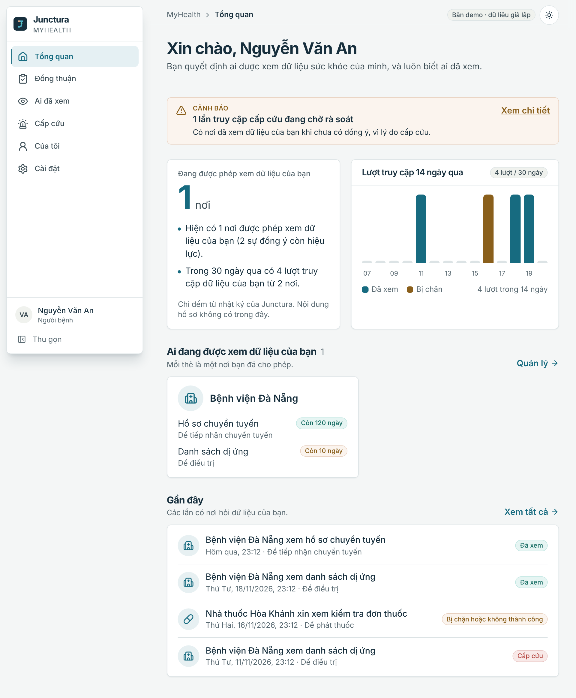
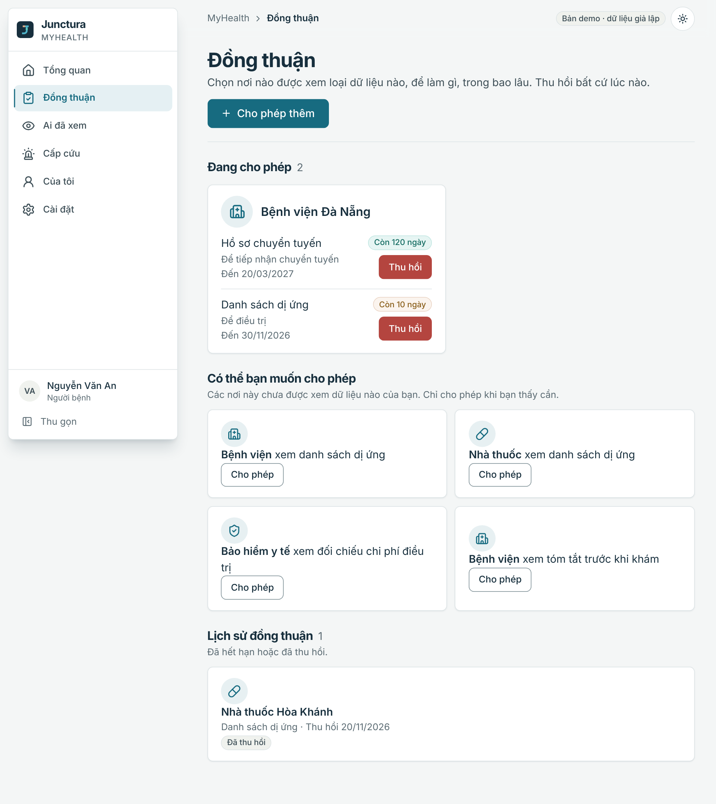
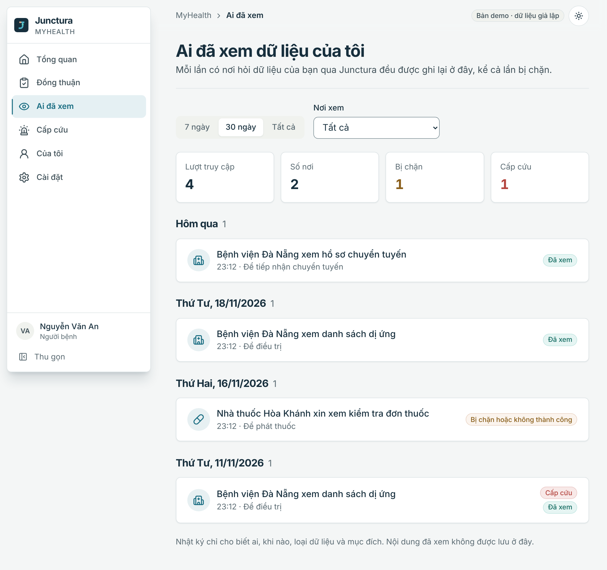
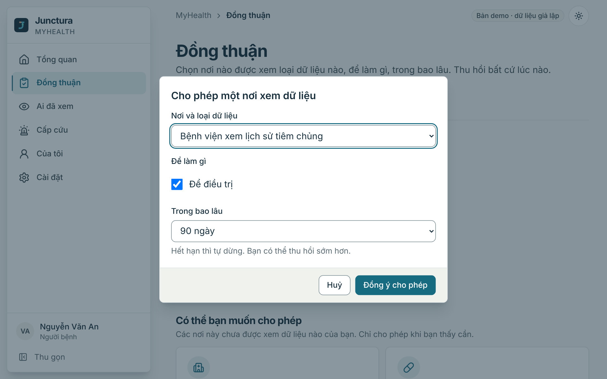
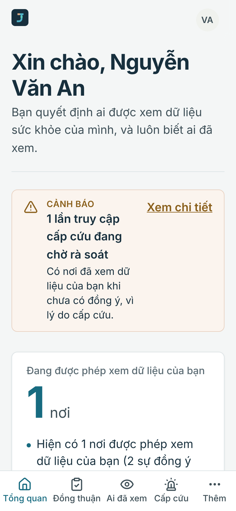
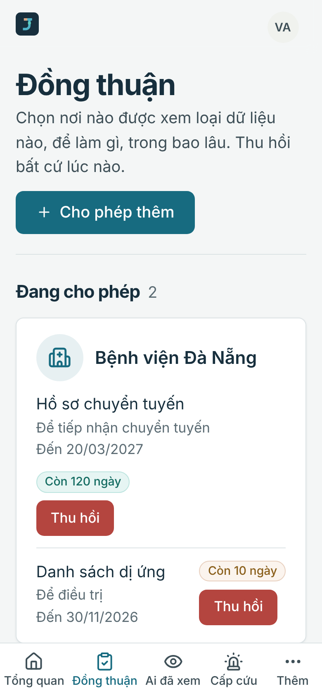
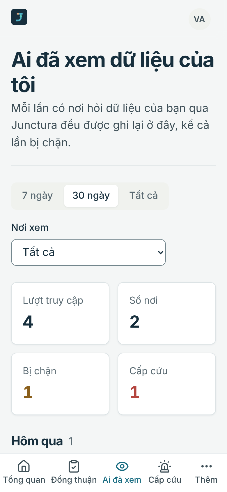
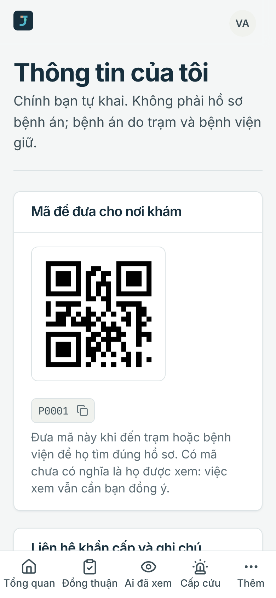
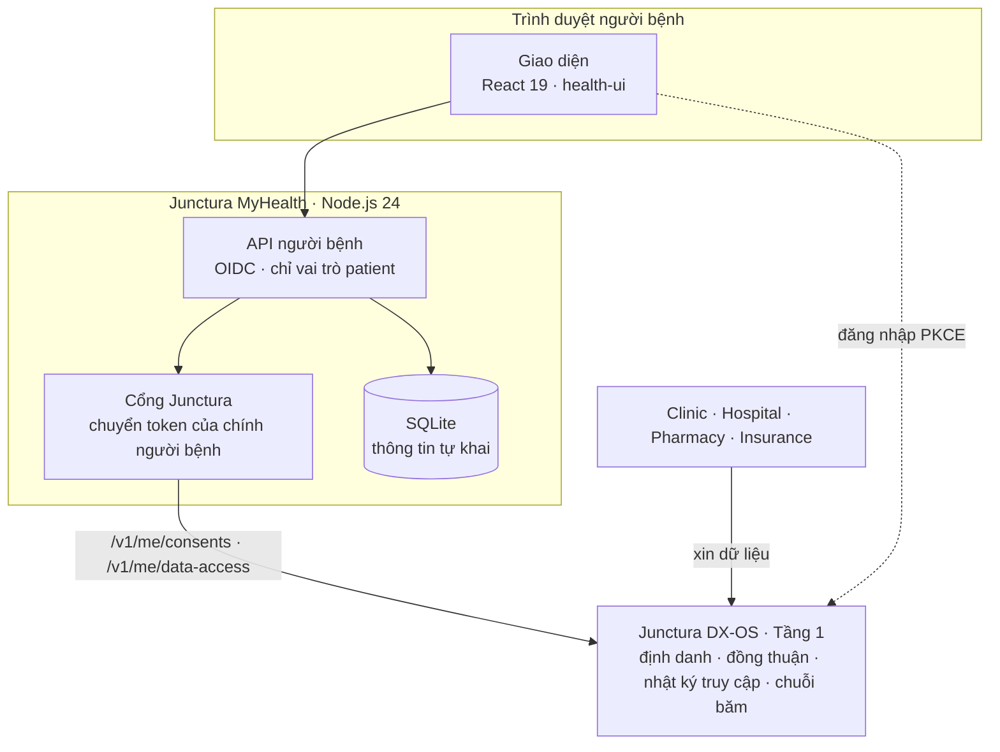
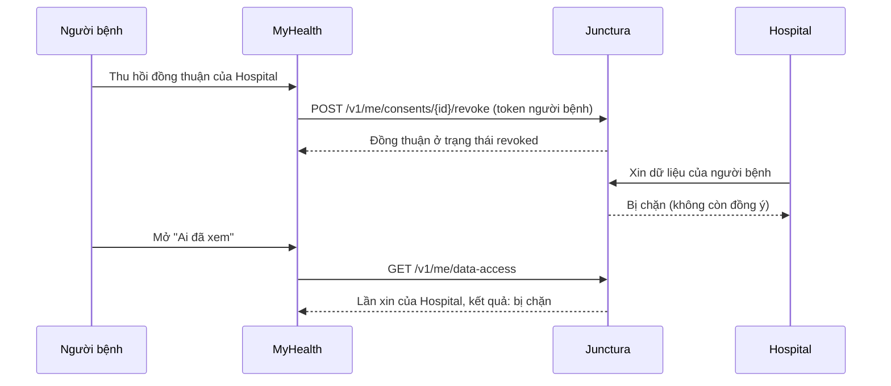

<!-- SPDX-FileCopyrightText: 2026 Junctura Contributors -->
<!-- SPDX-License-Identifier: Apache-2.0 -->

<div align="center">


# Junctura MyHealth

**Sổ sức khỏe của người bệnh — bạn quyết định ai được xem dữ liệu của mình, biết ai đã xem, và thu hồi bất cứ lúc nào.**

[](https://github.com/vku2-open-source-2026/junctura-myhealth/actions/workflows/ci.yml)
[](LICENSE)
[](REUSE.toml)


[Giới thiệu](#giới-thiệu) · [Giao diện](#giao-diện) · [Kiến trúc](#kiến-trúc) · [Bắt đầu nhanh](#bắt-đầu-nhanh) · [Cấu hình](#cấu-hình) · [Trang và API](#trang-và-api-chính) · [Tài liệu](#tài-liệu) · [Lộ trình](#lộ-trình)

</div>

---

## Giới thiệu

Dữ liệu sức khỏe của một người nằm rải rác ở trạm y tế, bệnh viện, nhà thuốc, cơ quan bảo hiểm. Người bệnh thường không biết nơi nào đang giữ gì, ai đã xem, và càng không có cách nào nói "không" sau khi đã lỡ đồng ý trên một tờ giấy.

**Junctura MyHealth** là ứng dụng dành cho chính người bệnh trong [Junctura Health](https://github.com/vku2-open-source-2026/junctura-health), Tầng 2 của [Junctura DX-OS](https://github.com/vku2-open-source-2026/junctura-dxos). Ứng dụng làm ba việc:

- **Cho phép** — chọn từng nơi, từng loại dữ liệu, từng mục đích, có thời hạn.
- **Theo dõi** — xem mọi lần có nơi hỏi dữ liệu của bạn, kể cả lần bị chặn và các lần truy cập cấp cứu.
- **Thu hồi** — đổi ý bằng một lần bấm, có hiệu lực ngay.

MyHealth **không giữ bệnh án**. Đồng thuận và nhật ký truy cập do Junctura (Tầng 1) lưu và bảo vệ bằng nhật ký chuỗi băm; MyHealth chỉ hiển thị và gửi yêu cầu của chính người bệnh. Chỉ phần người bệnh tự khai (liên hệ khẩn cấp, nhóm máu, ghi chú) được lưu cục bộ.

> Đây là sản phẩm demo cho cuộc thi; dữ liệu là **dữ liệu giả lập**, không có thông tin người thật.

### Ai dùng và dùng để làm gì

| Vai trò | Việc chính |
| --- | --- |
| **Người bệnh** (`patient`) | Cho phép và thu hồi đồng thuận, xem ai đã xem dữ liệu, xem truy cập cấp cứu, tự khai thông tin khẩn cấp |
| **Người nhà** | Dùng cùng giao diện với tài khoản của người bệnh; chữ lớn, mỗi màn hình một việc |

Tài khoản nhân viên (Clinic, Hospital, Pharmacy, Insurance) không vào được MyHealth.

## Tính năng nổi bật

**Đồng thuận**
- Cho phép một nơi xem một loại dữ liệu (hồ sơ chuyển tuyến, dị ứng, tiêm chủng, đơn thuốc, chi phí) **cho đúng mục đích** và trong 30 ngày đến 1 năm.
- "Đang cho phép" gom theo từng nơi, kèm số ngày còn lại (màu và chữ báo khi còn dưới 14 ngày); mục "Có thể bạn muốn cho phép" gợi ý các nơi chưa được xem gì, bấm là mở sẵn biểu mẫu; "Lịch sử đồng thuận" cho các lần đã hết hạn hoặc đã thu hồi.
- Thu hồi có hộp xác nhận nói rõ hậu quả; từ lúc thu hồi, nơi đó bị chặn.
- Lựa chọn được kiểm tra ở máy chủ trước khi gửi (nơi, mục đích nằm trong hợp đồng, thời hạn 1–365 ngày).

**Ai đã xem dữ liệu của tôi**
- Nhật ký từ Junctura: ai, lúc nào, loại dữ liệu, mục đích, kết quả (đã xem, đang xử lý, bị chặn). Nhóm theo ngày (giờ Việt Nam), có dải số liệu (lượt truy cập, số nơi, bị chặn, cấp cứu); lọc theo 7 ngày, 30 ngày, tất cả và theo nơi xem.
- Nhật ký **không chứa nội dung** đã xem, chỉ cho biết có lần truy cập.

**Cấp cứu**
- Khi tính mạng nguy cấp, nơi khám có thể xin xem dữ liệu mà chưa có đồng ý, kèm lý do. MyHealth giải thích quy trình ba bước, liệt kê các lần đó và trạng thái rà soát (chờ, hợp lý, không hợp lý).

**Tổng quan và thông tin của tôi**
- Tổng quan: số nơi đang được xem, biểu đồ lượt truy cập 14 ngày (có chữ mô tả, không chỉ dựa vào màu), thẻ theo từng nơi kèm hạn đồng thuận, năm lần truy cập gần nhất, cảnh báo cấp cứu chờ rà soát, kèm vài câu giải thích bằng lời thường (soạn theo quy tắc cố định, không dùng AI).
- Thông tin tự khai: người liên hệ khẩn cấp, nhóm máu, ghi chú; mã người bệnh dạng QR để đưa cho nơi khám.

**Thiết kế cho người lớn tuổi**
- Ưu tiên điện thoại, thanh điều hướng dưới, chữ lớn mặc định, vùng chạm lớn, sáng/tối, dùng được bằng bàn phím. Dựng trên [`@junctura/health-ui`](https://www.npmjs.com/package/@junctura/health-ui).

## Giao diện

Ảnh chụp từ bản demo với dữ liệu giả lập.

<table>
  <tr>
    <td width="50%"><br><sub><b>Tổng quan</b>: số nơi đang được xem, biểu đồ lượt truy cập 14 ngày, thẻ theo từng nơi, các lần gần đây</sub></td>
    <td width="50%"><br><sub><b>Đồng thuận</b>: gom theo nơi, gợi ý nơi chưa cho phép, lịch sử</sub></td>
  </tr>
  <tr>
    <td width="50%"><br><sub><b>Ai đã xem</b>: nhóm theo ngày, lọc theo thời gian và nơi</sub></td>
    <td width="50%"><br><sub><b>Cho phép</b>: chọn nơi, mục đích, thời hạn</sub></td>
  </tr>
</table>

<table>
  <tr>
    <td width="25%"><br><sub><b>Tổng quan</b></sub></td>
    <td width="25%"><br><sub><b>Đồng thuận</b>, thu hồi</sub></td>
    <td width="25%"><br><sub><b>Ai đã xem</b></sub></td>
    <td width="25%"><br><sub><b>Thông tin của tôi</b>, mã QR</sub></td>
  </tr>
</table>

## Kiến trúc



MyHealth không giữ khóa riêng của ứng dụng: mỗi lần gọi Junctura đều mang **chính token của người bệnh đang đăng nhập**, nên Junctura chỉ trả lời về người đó. MyHealth không gọi thẳng ứng dụng khác và không đọc cơ sở dữ liệu của ứng dụng khác.

### Thu hồi đồng thuận có tác dụng thế nào



### Những gì người bệnh có thể cho phép

Danh sách lấy từ [hợp đồng năng lực dùng chung](https://github.com/vku2-open-source-2026/junctura-health/tree/main/contracts) (`@junctura/health-contracts`): mỗi cặp (loại dữ liệu, nơi gọi) là một lựa chọn.

| Loại dữ liệu | Nơi xem | Mục đích |
| --- | --- | --- |
| Hồ sơ chuyển tuyến | Bệnh viện | Tiếp nhận chuyển tuyến |
| Tóm tắt trước khi khám | Bệnh viện | Điều trị |
| Danh sách dị ứng | Bệnh viện, Nhà thuốc | Điều trị, phát thuốc |
| Lịch sử tiêm chủng | Bệnh viện | Điều trị |
| Kiểm tra đơn thuốc | Nhà thuốc | Phát thuốc |
| Đối chiếu chi phí điều trị | Bảo hiểm y tế | Giám định chi phí |

### Mô hình bảo mật

| Lớp | Cơ chế |
| --- | --- |
| Xác thực | Đăng nhập Junctura (OpenID Connect, PKCE); máy chủ kiểm tra chữ ký RS256, nhà cấp, `azp` và hạn của token. Chỉ tài khoản vai trò `patient` của ứng dụng này vào được; người khác nhận 403 |
| Cô lập giữa người bệnh | Mỗi lời gọi tới Junctura mang token của chính người đó; không có tham số nào để chọn người khác |
| Kiểm tra đầu vào | Nơi, mục đích và thời hạn được kiểm tra ở máy chủ trước khi gửi; nội dung không hợp lệ không bao giờ tới Junctura |
| Không lộ nội dung | Nhật ký truy cập chỉ có ai, khi nào, loại dữ liệu, mục đích, kết quả |
| Lỗi trung thực | Khi Junctura không trả lời, ứng dụng nói rõ "chưa kết nối được", không hiện danh sách rỗng như thể chưa có ai xem |
| Dữ liệu cục bộ | Chỉ phần tự khai, trong SQLite theo `subject` của người đăng nhập |
| Bí mật | Không có khóa hay mật khẩu nào trong ứng dụng; mật khẩu chỉ nhập trên trang của Junctura |
| Tiêu đề bảo mật | CSP chỉ cho phép chính nó và nhà cấp định danh; `X-Frame-Options: DENY`; không lưu bộ nhớ đệm câu trả lời API |

## Bắt đầu nhanh

**Yêu cầu:** Git, Node.js 24 (xem `.node-version`). Chạy đủ cả hệ thống cần thêm Docker, [junctura-dxos](https://github.com/vku2-open-source-2026/junctura-dxos) đang chạy (`npm run local:up`) và [junctura-health](https://github.com/vku2-open-source-2026/junctura-health) đã chạy `npm run demo:setup`. Hai repo này nằm cạnh thư mục MyHealth; nếu ở nơi khác, đặt `JUNCTURA_HEALTH_DIR`.

```sh
git clone https://github.com/vku2-open-source-2026/junctura-myhealth.git
cd junctura-myhealth
npm ci                # cài thư viện máy chủ từ lockfile
npm run web:install   # cài thư viện giao diện từ lockfile
npm run build         # build giao diện vào web/dist
npm start             # chạy máy chủ
```

Hoặc dùng bản phát hành: tải `junctura-myhealth-0.1.0.tar.gz` và `junctura-myhealth-0.1.0.tar.gz.sha256` từ [Releases](https://github.com/vku2-open-source-2026/junctura-myhealth/releases), kiểm tra bằng `sha256sum -c junctura-myhealth-0.1.0.tar.gz.sha256`, giải nén (`tar -xzf junctura-myhealth-0.1.0.tar.gz`), vào thư mục `junctura-myhealth-0.1.0` rồi chạy các lệnh trên từ `npm ci`.

Mở <http://localhost:5183> và đăng nhập bằng `benhnhan.an` (Nguyễn Văn An). Mật khẩu demo nằm trong `.junctura/demo/accounts.env` của junctura-health. Tài khoản `benhnhan.binh` dùng cho cảnh cấp cứu.

**Xem trên điện thoại.** Đặt `HOST=0.0.0.0` rồi mở MyHealth bằng địa chỉ mạng nội bộ của máy. Chú ý: cổng đăng nhập chỉ chấp nhận địa chỉ đã đăng ký cho ứng dụng web (`localhost:5183`), nên để thử trên điện thoại thật cần đăng ký thêm địa chỉ đó trong Junctura.

**Chạy bằng Docker.** Cần Docker, Junctura DX-OS đang chạy ở máy bạn (`npm run local:up`) và junctura-health đã chạy `demo:setup`:

```sh
docker compose up --build
```

Mở <http://localhost:5183>. Compose dựng ảnh từ [`Dockerfile`](Dockerfile) (build nhiều giai đoạn, chạy bằng người dùng không phải root), gắn thư mục junctura-health ở chế độ chỉ đọc và lưu cơ sở dữ liệu trong volume `myhealth-data`. Nếu junctura-health nằm ở nơi khác, đặt `JUNCTURA_HEALTH_DIR` trước khi chạy.

**Phát triển giao diện.** Chạy `npm run dev:server` (API, cổng 5193) và `npm run dev` (giao diện, cổng 5183, tự chuyển `/api` sang 5193).

### Lệnh thường dùng

| Lệnh | Tác dụng |
| --- | --- |
| `npm start` | Chạy máy chủ và giao diện đã build |
| `npm run build` | Build giao diện vào `web/dist` |
| `npm run dev:server` · `npm run dev` | Chạy API và giao diện ở chế độ phát triển |
| `npm run check` | Kiểm tra header SPDX, tệp giấy phép, không đóng gói thư viện |
| `npm run check:reuse` | Kiểm tra tuân thủ REUSE 3.3 (cần `pip install -r requirements-reuse.txt`) |
| `npm test` · `npm run web:test` | Kiểm thử máy chủ · kiểm thử giao diện |

## Cấu hình

Máy chủ đọc kết nối từ `.junctura/demo/junctura-myhealth.env` do `demo:setup` tạo (mẫu: [`.env.example`](.env.example)); thiếu biến nào nó báo rõ biến đó. Biến môi trường thật luôn thắng giá trị trong file.

| Biến | Ý nghĩa | Mặc định |
| --- | --- | --- |
| `JUNCTURA_HEALTH_DIR` | Vị trí repo junctura-health (tài khoản demo, mã ứng dụng) | `../junctura-health` |
| `JUNCTURA_URL` | Địa chỉ Gateway của Junctura DX-OS; thiếu thì đồng thuận và nhật ký trả 503 | từ file demo |
| `JUNCTURA_ISSUER`, `JUNCTURA_WEB_CLIENT_ID` | Nhà cấp định danh và client đăng nhập (PKCE) của giao diện | từ file demo |
| `JUNCTURA_ISSUER_INTERNAL` | Địa chỉ dùng để lấy khóa xác thực khi địa chỉ công khai không truy cập được từ nơi chạy MyHealth (ví dụ trong container). Token vẫn được kiểm tra theo địa chỉ công khai | bằng `JUNCTURA_ISSUER` |
| `MYHEALTH_DB` | File SQLite của phần tự khai; xóa file để bắt đầu lại | `data/myhealth.db` |
| `PORT`, `HOST` | Địa chỉ lắng nghe của giao diện và API | `5183`, `127.0.0.1` |

MyHealth **không cần** `JUNCTURA_APP_CLIENT_SECRET`: nó không gọi Junctura bằng danh nghĩa riêng. Mã ứng dụng của các nơi có thể được cho phép đọc từ `junctura-health/.junctura/demo/*.env`; chưa chạy `demo:setup` thì màn hình "Cho phép" báo chưa có gì để chọn thay vì đoán mã.

## Trang và API chính

| Trang | Địa chỉ | Việc |
| --- | --- | --- |
| Tổng quan | `/` | Tóm tắt, biểu đồ 14 ngày, nơi đang được xem, lần gần đây, cảnh báo cấp cứu |
| Đồng thuận | `/dong-thuan` | Cho phép (có gợi ý), thu hồi, lịch sử |
| Ai đã xem | `/ai-da-xem` | Nhật ký truy cập theo ngày, lọc theo thời gian và nơi |
| Cấp cứu | `/cap-cuu` | Các lần truy cập cấp cứu và kết quả rà soát |
| Của tôi | `/thong-tin` | Mã QR, liên hệ khẩn cấp, nhóm máu, ghi chú |
| Cài đặt | `/cai-dat` | Cỡ chữ, giao diện tối, dữ liệu ứng dụng lưu |

| Endpoint | Mô tả |
| --- | --- |
| `GET /api/config` | Nhà cấp định danh và client đăng nhập (công khai) |
| `GET /api/me`, `GET /api/overview` | Người đang đăng nhập; số liệu tổng quan (nơi đang được xem, 14 ngày, gần đây) |
| `GET /api/options` | Những gì có thể cho phép (từ hợp đồng) |
| `GET/POST /api/consents`, `POST /api/consents/{id}/revoke` | Danh sách, cấp, thu hồi (chuyển tới Junctura `/v1/me/consents`) |
| `GET /api/access`, `GET /api/emergency` | Nhật ký truy cập, truy cập cấp cứu (từ `/v1/me/data-access`) |
| `GET/PUT /api/profile` | Thông tin tự khai |

Mọi endpoint (trừ `/api/config`) cần token của tài khoản `patient`.

## Công nghệ

| Thành phần | Công nghệ |
| --- | --- |
| Máy chủ | Node.js 24, không framework; [`@junctura/health-contracts`](https://www.npmjs.com/package/@junctura/health-contracts) |
| Lưu trữ | SQLite qua `node:sqlite` (có sẵn trong Node, không thêm thư viện) |
| Giao diện | React 19, Vite, TypeScript, [`@junctura/health-ui`](https://www.npmjs.com/package/@junctura/health-ui), `qrcode` (MIT) |
| Tầng 1 | Junctura DX-OS: định danh, đồng thuận, nhật ký truy cập (gọi qua API, không viết lại) |
| Đóng gói, CI | npm, Docker, GitHub Actions |

Thư viện bên thứ ba được khai trong `package.json` và `package-lock.json`, cài từ registry; không chép mã nguồn của chúng vào repo. Phiên bản và giấy phép: [THIRD-PARTY.md](THIRD-PARTY.md).

## Tài liệu

| | |
| --- | --- |
| [CONTRIBUTING.md](CONTRIBUTING.md) | Quy trình đóng góp, quy tắc bắt buộc |
| [CHANGELOG.md](CHANGELOG.md) | Lịch sử thay đổi |
| [SECURITY.md](SECURITY.md) | Cách báo lỗ hổng bảo mật |
| [CODE_OF_CONDUCT.md](CODE_OF_CONDUCT.md) | Quy tắc ứng xử |
| [THIRD-PARTY.md](THIRD-PARTY.md) | Thư viện bên thứ ba và giấy phép |
| [`.env.example`](.env.example) | Mẫu biến môi trường |
| [Tính năng từng ứng dụng](https://github.com/vku2-open-source-2026/junctura-health/blob/main/docs/APPS.md) | Phạm vi MyHealth và kịch bản demo |
| [Quy tắc thiết kế](https://github.com/vku2-open-source-2026/junctura-health/blob/main/docs/DESIGN.md) | An toàn hiển thị, giao diện dùng chung |
| [Junctura DX-OS](https://github.com/vku2-open-source-2026/junctura-dxos) | Tầng 1: định danh, đồng thuận, nhật ký |

## Cấu trúc thư mục

```text
server/         API, cổng Junctura, danh mục đồng thuận, tổng quan, SQLite
web/            giao diện React (web/src)
tests/          kiểm thử máy chủ
scripts/        kiểm tra cú pháp và REUSE
docs/           logo, ảnh chụp màn hình
Dockerfile      ảnh container (build nhiều giai đoạn)
compose.yaml    chạy MyHealth bằng Docker
```

## Kiểm thử

```sh
npm run check         # header SPDX, giấy phép, không đóng gói thư viện
npm run check:reuse   # REUSE 3.3
npm test              # máy chủ: xác thực, cô lập người bệnh, đồng thuận, nhật ký, tự khai, lỗi Junctura
npm run web:test      # giao diện: đồng thuận, ai đã xem, cấp cứu, thông tin, trang chào
```

GitHub Actions chạy cả bốn lệnh ở mỗi Pull Request.

## Lộ trình

- [x] Đăng nhập chỉ cho vai trò người bệnh.
- [x] Cho phép, thu hồi, lịch sử đồng thuận qua Junctura.
- [x] Nhật ký "Ai đã xem", truy cập cấp cứu, tổng quan.
- [x] Thông tin tự khai và mã QR người bệnh.
- [x] Đóng gói Docker, quy trình phát hành `.tar.gz`.
- [ ] Gia hạn đồng thuận (hiện thu hồi rồi cho phép lại).
- [ ] Người bệnh phản hồi một lần truy cập cấp cứu (Junctura hiện chỉ cho cơ quan quản lý rà soát).
- [ ] Xem hồ sơ của chính mình (cần thêm một hợp đồng `health-record-view` ở junctura-health).
- [ ] Nhắc tiêm chủng.
- [ ] Bản phát hành `v0.1.0` kèm gói `.tar.gz`.

Tiến độ chi tiết ở [Issues](https://github.com/vku2-open-source-2026/junctura-myhealth/issues).

## Đóng góp

Mọi đóng góp đều được hoan nghênh. Báo lỗi và đề xuất tại [Issues](https://github.com/vku2-open-source-2026/junctura-myhealth/issues); lỗ hổng bảo mật báo theo [SECURITY.md](SECURITY.md). Trước khi gửi Pull Request, đọc [CONTRIBUTING.md](CONTRIBUTING.md) và [Quy tắc ứng xử](CODE_OF_CONDUCT.md). Commit theo chuẩn Conventional Commits và không bao giờ commit tệp `.env` hay khóa bí mật. Lịch sử thay đổi: [CHANGELOG.md](CHANGELOG.md).

## Giấy phép

Junctura MyHealth là phần mềm tự do, phát hành theo [Apache License 2.0](LICENSE), một giấy phép nguồn mở được OSI phê chuẩn — Copyright 2026 Junctura Contributors. Bạn được dùng, sửa đổi và phân phối lại (kể cả cho mục đích thương mại), miễn là giữ lại thông báo bản quyền và giấy phép, ghi rõ các thay đổi; giấy phép cũng cấp quyền sử dụng bằng sáng chế liên quan và không kèm bảo hành.

<!-- REUSE-IgnoreStart -->
- Mỗi tệp mã nguồn đều ghi giấy phép bằng tiêu đề [SPDX](https://spdx.dev/) (`SPDX-License-Identifier: Apache-2.0`); các tệp không chứa được chú thích (JSON, dữ liệu) được khai báo trong [REUSE.toml](REUSE.toml). Dự án tuân thủ chuẩn [REUSE 3.3](https://reuse.software/), kiểm tra bằng `reuse lint`.
<!-- REUSE-IgnoreEnd -->
- Toàn văn giấy phép: [LICENSE](LICENSE) · thông báo bản quyền: [NOTICE](NOTICE).
- Thành phần bên thứ ba giữ giấy phép riêng và đều là giấy phép nguồn mở; chúng được khai trong `package.json`, cài từ registry, không chép hay sửa mã nguồn. Danh sách, phiên bản và giấy phép tại [THIRD-PARTY.md](THIRD-PARTY.md).
